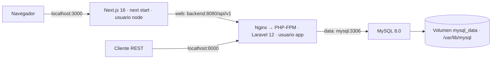

# multi-stage-docker

Ecosistema de comercio electrónico basado en las aplicaciones `ecommerce2` y `ecommerce-api` de Marlon Castillo. Incluye catálogo, carrito, registro/inicio de sesión con JWT, pedidos con reserva de inventario y la integración existente con Stripe. Las aplicaciones originales no se modifican ni se importan sus bases de datos o credenciales.

## Arquitectura



Son **tres servicios**. Nginx y PHP-FPM comparten el contenedor backend, administrados por Supervisor. `web` comunica frontend/backend; `data` es una red interna que comunica backend/MySQL. MySQL no publica puertos al host y el frontend no pertenece a su red. Next realiza las llamadas a Laravel en el servidor; el navegador no necesita resolver nombres internos de Docker ni configurar CORS. Los puertos del host se enlazan a 127.0.0.1.

## Requisitos y arranque

Docker Engine/Desktop con Compose v2 y BuildKit, Git y OpenSSL. No se necesita PHP, Composer, Node ni MySQL instalados en el host para ejecutar la aplicación. 

```bash
git clone https://github.com/MarlonCastillo-Git/multi-stage-docker.git
cd multi-stage-docker
./scripts/setup.sh
docker compose up --build
```

`setup.sh` genera `.env` con claves aleatorias y permisos privados; si ya existe, lo conserva. `.env.example` documenta cada variable. El paso de configuración se hace una vez. Para ejecutar en segundo plano:

```bash
docker compose up --build -d
docker compose ps
```

- Registro: http://localhost:3000/registro
- Tienda: http://localhost:3000/catalogo
- API: http://localhost:8000/api/v1/products
- Salud de API y conexión MySQL: http://localhost:8000/health

Compose espera a que MySQL acepte consultas antes de iniciar Laravel. El backend ejecuta las migraciones y, si `SEED_DEMO=true`, inserta tres productos. La carga inicial es idempotente: no restablece existencias ni crea usuarios con contraseñas predeterminadas. Luego inicia Nginx/PHP-FPM; Next arranca cuando la API está saludable. Para comprar, registre su cuenta, agregue productos y cree una orden. El precio y el stock se validan en Laravel dentro de una transacción.

## Decisiones de los Dockerfiles

### Frontend

1. `base` usa Node 24 Alpine, compatible con el proyecto y el gestor pnpm fijado. Se elige esta versión en lugar de la recomendación Node 20. Se desactiva telemetría.
2. `tooling` instala pnpm **12.3.4**. Los manifiestos se copian antes del código para reutilizar la capa de dependencias.
3. `dependencies` instala con `--frozen-lockfile`; el montaje de caché BuildKit conserva descargas entre builds.
4. `build` ejecuta `next build` y elimina la caché de compilación. La clave pública de Stripe es un argumento de build; jamás se pasan secretos privados al frontend.
5. `production-dependencies` instala dependencias de producción y elimina mapas de fuente JavaScript que no necesita `next start`.
6. `runtime` recibe `.next`, `public`, configuración JavaScript y dependencias de producción. No recibe código `src`, pruebas, pnpm ni dependencias de desarrollo. Ejecuta **next start** en puerto 3000 como usuario `node`. Se conserva esta modalidad solicitada en lugar de un servidor standalone.

### Backend

1. `php-base` parte de PHP 8.2 FPM Alpine, instala `pdo_mysql`, `bcmath` (totales monetarios), `mbstring`, `xml` y OPcache; elimina las herramientas de compilación en la misma capa. OpenSSL, tokenizer, ctype y JSON vienen incorporados en la base PHP y se verifican en ejecución.
2. `dependencies` incorpora Composer únicamente para el build. Instala `composer.lock` sin paquetes de desarrollo, difiere scripts/autoload hasta copiar el código y genera autoload optimizado.
3. `runtime` copia el código de la API y **solo `vendor/` desde la etapa Composer**. No copia Composer ni herramientas de build. Nginx escucha en 8080 y pasa únicamente `index.php` a FPM por loopback:9000. Ambos procesos se ejecutan con UID 10001. Supervisor los reinicia y Compose incorpora un init para señales y procesos hijos.
4. PHP usa configuración de producción; OPcache no revisa cambios porque el código se despliega reconstruyendo la imagen. Solo `storage` y `bootstrap/cache` tienen escritura para la aplicación. Logs van a stdout/stderr. `APP_DEBUG=false` y las claves se inyectan al iniciar; no se incluyen en las capas.
5. El entrypoint prepara la caché de configuración y aplica migraciones antes de aceptar tráfico. Este diseño corresponde a una sola réplica; para varias réplicas se debe ejecutar la migración como tarea de despliegue independiente.

### MySQL y persistencia

Se usa directamente la imagen oficial MySQL 8.0; no hay código que compilar ni hace falta inventar un Dockerfile multi-stage para la base. Recibe `MYSQL_ROOT_PASSWORD`, `MYSQL_DATABASE`, `MYSQL_USER`, `MYSQL_PASSWORD`. Laravel usa el usuario de aplicación, no root. Los datos viven en el volumen nombrado `multi-stage-docker_mysql_data`, montado en `/var/lib/mysql`.

No se necesita SQL de inicialización: Laravel administra el esquema mediante migraciones. Si se agrega un script a `/docker-entrypoint-initdb.d/`, MySQL lo ejecutará **solo al inicializar un volumen vacío**. Cambiar las contraseñas en `.env` no cambia las cuentas de una base ya inicializada.

## Verificar el flujo y la persistencia

Con los servicios saludables :
Salud de API y conexión MySQL: http://localhost:8000/health

Realice la verificación manual:

1. Regístrese en la tienda y cree una orden; anote su número.
- Registro: http://localhost:3000/registro
- Tienda: http://localhost:3000/catalogo

2. Ejecute `docker compose down` para eliminar los contenedores.
3. Ejecute `docker compose up -d --wait` para recrearlos.
4. Inicie sesión con la misma cuenta y consulte **Mis compras**. El pedido y las existencias se conservan.

**No use `docker compose down -v` para esta prueba**: `-v` elimina el volumen y sus datos. Un volumen persistente no sustituye una copia de seguridad. Conserve también `.env`: la clave de aplicación y el secreto JWT deben permanecer estables.

## Caché, tamaño y reproducibilidad

Las bases Node, PHP, Composer y MySQL están fijadas por digest; pnpm y las dependencias PHP/JS también están fijados. `.dockerignore` excluye secretos, dependencias del host, cachés, pruebas y bases locales. Cambiar solo código reutiliza la instalación de dependencias. Los paquetes Alpine instalados mediante `apk` dependen del repositorio de distribución: esto no promete imágenes idénticas bit a bit. Los digests deben actualizarse periódicamente junto con pruebas para incorporar parches.

```bash
docker compose build
docker image ls 'multi-stage-docker-*'
docker compose logs --tail=100
```

El informe `docs/VERIFICACION.md` registra los resultados reales y tamaños medidos.

## Stripe y despliegue público

Stripe es opcional para catálogo, usuarios y órdenes. Para completar pagos, configure claves **de prueba** y el secreto del webhook en `.env`, registre el endpoint `/api/v1/stripe/webhook` con Stripe y reconstruya el frontend si cambia su clave pública. Sin claves válidas no se verifica ni se simula un pago exitoso.

Los contenedores son de producción, pero el acceso entregado es local HTTP. Para exponer la tienda públicamente, configure un proxy TLS, dominio, `APP_URL` HTTPS y las URL públicas apropiadas. Añada copias de seguridad, monitoreo y gestión de secretos según su infraestructura. No publique `.env`, volcados SQL ni claves Stripe. Las capacidades Linux se eliminan en frontend/backend y se activa `no-new-privileges`; esto reduce privilegios, no certifica ausencia de vulnerabilidades.

## Estructura

```text
frontend/             Código Next.js, lockfile y Dockerfile
backend/              API Laravel, composer.lock y Dockerfile
backend/docker/       Nginx, Supervisor, PHP y entrypoint
docker-compose.yml    Servicios, salud, redes y volumen
.env.example          Variables documentadas
scripts/setup.sh      Generación local de secretos
docs/VERIFICACION.md   Evidencia de ejecución
```

Los componentes de terceros conservan sus licencias en sus distribuciones; se mantiene el código fuente de las aplicaciones previamente desarrolladas.
