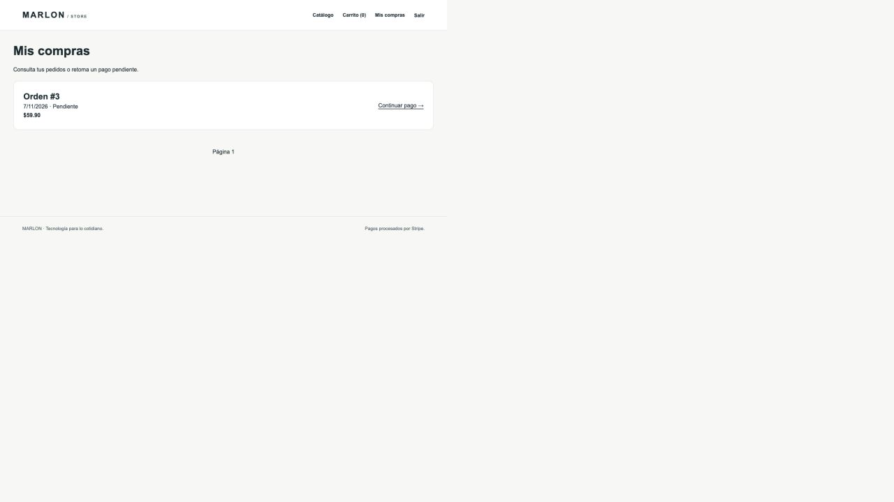

# Verificación del ecosistema

Ejecución local: 6 de noviembre de 2026 (El Salvador), macOS Apple Silicon con Docker Desktop, contenedores Linux ARM64. No se verificó ejecución nativa AMD64.

## Resultado

Los tres servicios quedaron saludables. Se verificaron el flujo Next.js → Laravel → MySQL y la persistencia tras eliminar y recrear los tres contenedores, conservando el volumen nombrado.

```text
PASS: Laravel conecta con MySQL
PASS: Next muestra el producto real obtenido de Laravel/MySQL
PASS: Formulario real de registro de Next disponible
PASS: Registro mediante Next crea sesión JWT
PASS: Orden calcula el total correcto
PASS: Orden descuenta existencias en MySQL
PASS: Usuario y orden siguen disponibles por API
PASS: Next muestra el pedido persistido en Mis compras
PASS: Consulta SQL confirma el pedido en MySQL
PASS: Los tres contenedores fueron reemplazados
PASS: Usuario y orden siguen disponibles por API
PASS: Next muestra el pedido persistido en Mis compras
PASS: Consulta SQL confirma el pedido en MySQL
PASS: El reinicio conserva el stock; el seeder no lo restablece
VERIFICACIÓN COMPLETA: orden #4. Stripe no se prueba.
```

El verificador usa el formulario HTML real de registro de Next (Server Action), autentica contra Laravel, crea un pedido por REST, comprueba el descuento de inventario, lee el historial renderizado por Next y verifica el registro con una consulta SQL. Compara los IDs Docker antes/después para demostrar que los contenedores sí fueron reemplazados.

Además se verificó en el navegador integrado: registro, detalle de producto, añadir al carrito y creación de la **orden #3 por $59.90 mediante Next.js**. Esa misma orden sigue visible en el historial después de recrear los contenedores. La fecha mostrada en la captura usa UTC; la ejecución local corresponde al 6 de noviembre.



## Controles técnicos

- `docker compose config --quiet`: correcto.
- Build de producción Next.js **16.4.1** y TypeScript: correcto.
- Tres pruebas unitarias de validación del frontend: correctas.
- PHP **8.2.35**, Node **24.22.2** y Laravel **12.69.2** según dependencias y runtime verificados.
- Extensiones presentes: pdo_mysql, mbstring, openssl, tokenizer, xml, ctype, json, bcmath y OPcache.
- Frontend UID 1000, backend UID 10001; ambos sin root. Composer y gcc ausentes del backend final; TypeScript y `src/` ausentes del frontend final.
- MySQL sin puerto publicado al host; volumen montado en `/var/lib/mysql`.
- Revisión de archivos preparados para Git: `.env`, dependencias, cachés y base local excluidos; no se encontraron las credenciales generadas ni los patrones de secretos revisados. No equivale a una auditoría exhaustiva de seguridad.

## Tamaños y caché

Valores de `docker image inspect --format '{{.Size}}'` en este Docker Desktop:

| Imagen | Bytes reportados | MB decimales |
|---|---:|---:|
| Frontend final | 609190163 | 609.19 |
| Backend final | 280396320 | 280.40 |

La eliminación de mapas de fuente de dependencias redujo el valor reportado del frontend de 747998058 a 609190163 bytes (18,56 % respecto a la primera imagen creada en este proyecto). No es una comparación con las imágenes básicas originales del equipo. El tamaño reportado por Docker y el espacio físico compartido entre imágenes pueden diferir; no representa el tamaño comprimido de descarga.

Build repetido sin cambios: **2.33 segundos**, código de salida 0, usando caché. No representa el tiempo de un build limpio ni una garantía para otros equipos.

## Límites

- No se realizaron cobros ni validación contra Stripe: faltan credenciales de prueba configuradas. El pedido queda pendiente de pago.
- La ejecución autónoma de Chrome con Playwright fue bloqueada por el entorno local; el recorrido visual se completó con el navegador integrado. `frontend/tests/docker-e2e.mjs` queda disponible para un entorno con Playwright/Chromium habilitados.
- Se comprobó HTTP local. TLS, despliegue remoto, carga, copias de seguridad y escaneo de vulnerabilidades quedan fuera de esta ejecución.
- No se ejecutó de nuevo la suite PHPUnit de la aplicación original en este proyecto. Las pruebas de integración descritas sí se ejecutaron contra MySQL real en contenedores.

## Repetir

```bash
./scripts/setup.sh
docker compose up --build -d --wait
python3 scripts/verify.py --recreate
```

El script crea usuarios y pedidos de prueba, conserva el volumen y deja los servicios levantados. No ejecute `down -v` si desea conservar datos.
